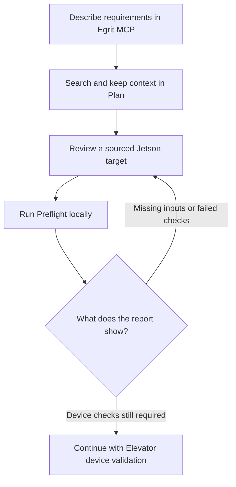

<!-- Maintained in denissutherland52/Egrit; copy to Egrit-AI/.github/profile/README.md after review. -->

# Egrit

Last updated: 2026-10-31

**Find compute you can actually use. Build a clearer path from cloud to device.**

Egrit is a family of developer tools from Neul Space Ltd. Start with Search
through the existing Egrit MCP to find GPU and AI compute against your
requirements. Keep the working context in Plan. For Jetson development,
run Preflight locally and use its report to identify what still needs
checking before physical device validation.

[Connect Egrit MCP](https://github.com/Egrit-AI/egrit-search/blob/main/docs/mcp.md)
 · [Explore Search](https://github.com/Egrit-AI/egrit-search)
 · [Run Preflight locally](https://github.com/Egrit-AI/egrit-preflight)
 · [Website](https://www.egrit.ai)

## Start with the existing MCP

Ask your connected assistant: "Find compute for my requirements and show
which requirements each result meets, with the reasons and missing information."

Use the [connection guide](https://github.com/Egrit-AI/egrit-search/blob/main/docs/mcp.md)
for the hosted endpoint or local stdio setup. Access depends on the service
and your client. Check the tools your connection exposes: a roadmap item is
not an installed tool. Hosted MCP cannot access your local Docker or Jetson.

## What each tool does

| Part | Purpose | Availability boundary |
|---|---|---|
| Search and DeepDive | Find compute and inspect the supporting technical information | Existing MCP/API capabilities; deployment and connection determine the tools exposed |
| Plan | Keep requirements, search results and explicitly attached reports together | Local report attachment is implemented; the joined hosted report journey is in development |
| Preflight | Inspect ARM64 images and run bounded CPU-only checks locally | Free, open-source CLI; target preparation and report explanation through MCP are in development |
| Elevator | Carry the image and target context towards physical device checks | Local report intake exists; device validation and deployment have separate gates |

## A developer journey

The diagram shows the intended joined journey. It does not mean every step
is available through MCP today.

For an Orin Nano project, first establish the installed or intended JetPack
release. Use a sourced [target example](https://github.com/Egrit-AI/egrit-preflight/tree/main/examples/targets)
and a digest-pinned image. Run Preflight with that target, review the report,
then attach it to a local Plan. The proposed MCP preparation and explanation
tools will help with these steps once released.

A report can be accepted while its checks fail. Missing facts remain
unresolved. An ARM64 CPU pass is not a Jetson GPU pass, and no report import
establishes CUDA, TensorRT, power or flight performance. A physical device
is required for those checks.

## Free local tools and Pro continuity

Preflight needs no account or subscription. Local Plan report attachment
and Elevator report intake do not require a Pro account. The Pro direction
adds account-owned hosted continuity and history; the complete hosted report
workflow is still in development. This is not a pricing or availability
promise for managed Elevator deployment.

Search keeps provider statements, observations and missing information
distinct. Egrit does not reserve compute or decide whether your organisation
may use a provider. Your authorised team makes that decision.

## About

Egrit is a product of Neul Space Ltd, registered in England and Wales.
